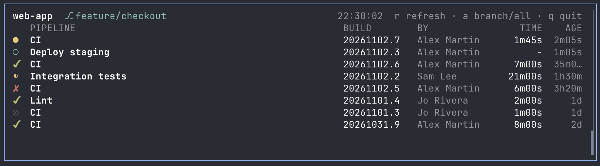

# herdr Azure DevOps

[](https://github.com/arthurgiroux/herdr-azure-devops-plugin/actions/workflows/ci.yml)

A herdr plugin for Azure DevOps. It currently shows live builds for the repo and branch of the current workspace, and raises a herdr toast when a build finishes. Works with Azure DevOps Services (`dev.azure.com` and `*.visualstudio.com`).



## Requirements
- herdr 0.9.3 or later
- Python 3.11 or later
- Azure CLI logged in (`az login`), or a personal access token (see Auth)
- git

## Install
```sh
herdr plugin install arthurgiroux/herdr-azure-devops-plugin
```
For development, link a local checkout instead:
```sh
herdr plugin link "$PWD"
```

## Use
Run the action from a workspace pane on an Azure DevOps repo:
```sh
herdr plugin action invoke arthurgiroux.azure-devops.builds
```
Or bind a key in herdr `config.toml`:
```toml
[[keys.command]]
key = "prefix+shift+b"
type = "plugin_action"
command = "arthurgiroux.azure-devops.builds"
description = "Show Azure DevOps builds"
```
In the pane: `r` refreshes, `a` switches between the current branch and all builds of the project (no finish toasts in the project view), `q` quits.

## Config
Optional `config.toml` in `herdr plugin config-dir arthurgiroux.azure-devops`:
```toml
poll_seconds = 15      # refresh interval, minimum 5
top_builds = 15        # builds shown, 1 to 100
notify = "all"         # "all", "failures" or "off"
pat_cmd = "..."       # command that prints the PAT, see Auth
remote = "origin"      # git remote to use; default: upstream remote, then origin, then first Azure DevOps remote
```
An invalid file is reported in the pane.

## Auth
Default: Azure CLI token (`az login`). If your tenant has no Azure DevOps service principal (AADSTS500011), or you prefer not to use the CLI, use a PAT with scopes `Build (Read)` and `Code (Read)`.

### Secret store (`pat_cmd`, recommended)
Set `pat_cmd` in `config.toml` to a shell command that prints the PAT. It runs through `sh -c` with the organization name in `$AZURE_DEVOPS_ORG`; a non-zero exit or empty output counts as "not found".

macOS Keychain (the prompt keeps the token out of shell history):
```sh
security add-generic-password -U -s herdr-azure-devops -a my-org -w
```
```toml
pat_cmd = 'security find-generic-password -s herdr-azure-devops -a "$AZURE_DEVOPS_ORG" -w'
```
Linux (GNOME Keyring or KWallet through libsecret):
```sh
secret-tool store --label="herdr Azure DevOps" service herdr-azure-devops account my-org
```
```toml
pat_cmd = 'secret-tool lookup service herdr-azure-devops account "$AZURE_DEVOPS_ORG"'
```
Any other tool works too (`pass`, 1Password `op read`, and so on).
### Plain file (not recommended)
Stores the token unencrypted. Write it to a file in the config dir (paste it, then press Ctrl-D):
```sh
dir="$(herdr plugin config-dir arthurgiroux.azure-devops)"
mkdir -p "$dir"
(umask 077; cat > "$dir/pat")
```

### Precedence
`pat.<org>` file, `pat_cmd`, `pat` file, then `AZURE_DEVOPS_EXT_PAT`. If none is found the Azure CLI token is used.

`pat` applies to every organization. For a different PAT per organization, name the file `pat.<org>`, for example `pat.my-org`; it overrides `pat`. 

## Troubleshooting
- `AADSTS500011`: your tenant lacks the Azure DevOps service principal; use a PAT.
- `Access denied` / 401: the PAT is invalid or expired, or run `az login` again.
- Permission denied / 403: the account or PAT lacks Build (Read) or Code (Read).
- `Detached HEAD`: check out a branch in the workspace pane.
- `No Azure DevOps remote found`: the repo has no `dev.azure.com` or `visualstudio.com` remote; set `remote` if you have several.
- Python version errors: install Python 3.11 or later and make sure `python3` points to it.

Errors from the `open` action appear in `herdr plugin log`.

## Demo
Set `AZURE_DEVOPS_DEMO=1` to show dummy builds, for example for screenshots:
```sh
AZURE_DEVOPS_DEMO=1 python3 -m azure_devops
```

## Test
```sh
python3 -m unittest discover tests
```

## License
MIT
